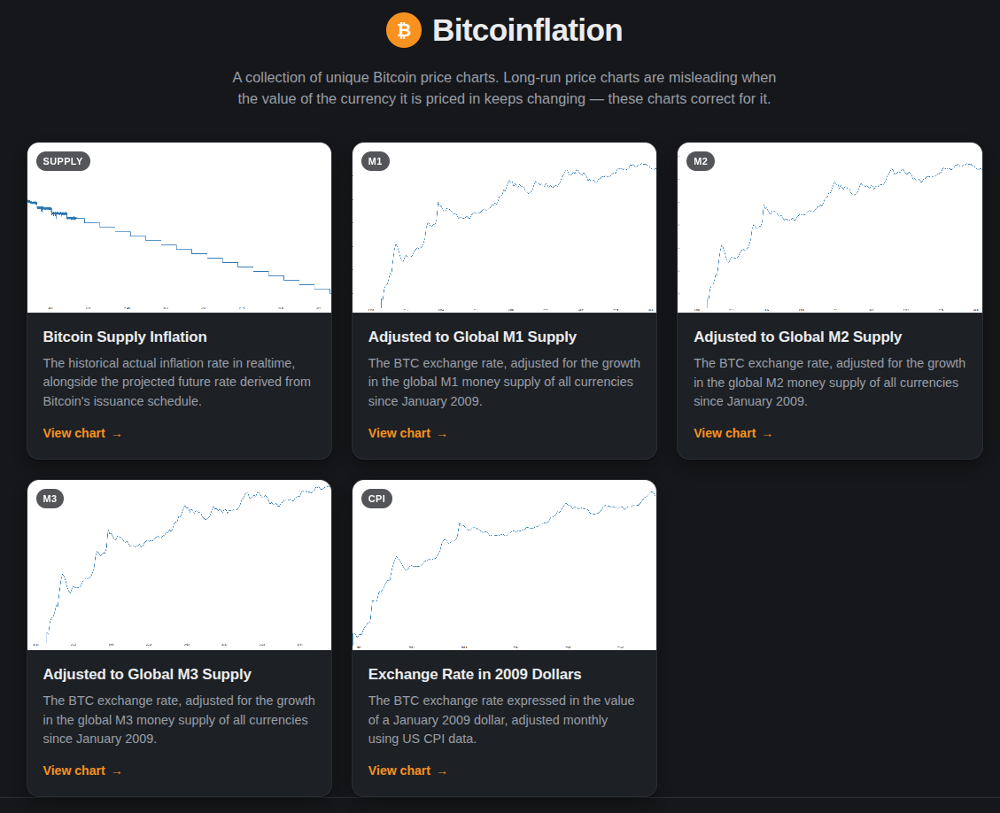

# bitcoinflation

A Collection of Unique Bitcoin Price Charts



## Charts

| Chart | Directory |
| --- | --- |
| Bitcoin Supply Inflation | `btc-supply-inflation/` |
| Bitcoin Supply Adjusted to Global M1 Supply | `btc-global-m1-adjusted/` |
| Bitcoin Supply Adjusted to Global M2 Supply | `btc-global-m2-adjusted/` |
| Bitcoin Supply Adjusted to Global M3 Supply | `btc-global-m3-adjusted/` |
| Bitcoin Exchange Rate in 2009 Dollars (CPI) | `cpi-adjusted-exchange-rate/` |
| Bitcoin Priced in Gold | `btc-in-gold/` |
| Raw vs. Money Supply Adjusted | `btc-raw-vs-adjusted/` |
| What One Bitcoin Buys (Homes & Hours of Work) | `btc-in-real-goods/` |
| Global Money Supply Growth | `global-money-supply-growth/` |
| Purchasing Power of the Dollar | `usd-purchasing-power/` |

The three money supply charts all share one adjustment: the money supply of
every reporting country, converted to USD at that country's own exchange rate
and summed. See "Global money supply" below. The `btc-raw-vs-adjusted` chart
reuses that same M3 adjustment, rebased so the plain and adjusted prices can
share one axis.

## Updating the data

The CSV/JSON datasets are refreshed from free, key-less APIs by running:

```sh
python3 update_data.py
```

| Dataset | Source |
| --- | --- |
| `monthly-btc-usd-exchange-rate.csv` | [blockchain.info](https://www.blockchain.com/explorer/charts/market-price) chart API (full history, month-end close) |
| `global-money-supply-usd.csv` | [OECD SDMX](https://data-explorer.oecd.org/) dataflow `DSD_STES@DF_MONAGG` (national money stocks) combined with [BIS SDMX](https://data.bis.org/) dataflow `WS_XRU` (month-end exchange rates) |
| `global-money-supply.csv` | Same as above, all three measures in one table for auditing |
| `monthly-usd-inflation-rate.csv` | [FRED `CPIAUCNS`](https://fred.stlouisfed.org/series/CPIAUCNS), month-over-month % change |
| `historic-btc-inflation-rate.json` / `.csv` | [CoinMetrics community API](https://docs.coinmetrics.io/api/v4/) `SplyCur` (daily supply) |
| `latest-supply.json` | Anchor (date + supply) for the forward projection in the supply inflation chart |
| `gold-price-usd.csv` | [Yahoo Finance](https://finance.yahoo.com/quote/GC=F/) chart API, front-month COMEX gold (`GC=F`), month-end close |
| `us-home-price-and-wages.csv` | [FRED `MSPUS`](https://fred.stlouisfed.org/series/MSPUS) (median new-home sale price) and [FRED `CES0500000003`](https://fred.stlouisfed.org/series/CES0500000003) (average hourly earnings), forward-filled to monthly |
| `global-money-supply-yoy.csv` | Year-over-year percent change of `global-money-supply.csv`, computed locally |
| `purchasing-power.csv` | [FRED `CPIAUCNS`](https://fred.stlouisfed.org/series/CPIAUCNS) inverted and indexed to January 2009 |

Each chart also shows a realtime spot price, fetched at request time from the
free [Coinbase spot price API](https://api.coinbase.com/v2/prices/BTC-USD/spot).

## Global money supply

The `btc-global-m{1,2,3}-adjusted` charts adjust the BTC exchange rate by the
change in the world money supply, expressed in USD, since January 2009.

Two free sources are combined:

- **Money stocks** — the OECD's monthly narrow money (`MANM`) and broad money
  (`MABM`) for each reporting country, in that country's own currency. The OECD
  also publishes an aggregate, but it is an index rather than a level, so the
  national series are summed instead.
- **Exchange rates** — the BIS monthly month-end rate of each currency against
  the USD.

Each country's stock is converted at its **own** end-of-period rate before the
results are summed. That ordering matters: adding the local-currency amounts
first and converting once would let a currency depreciation show up as money
growth.

Coverage is 30 areas — the 29 OECD member countries plus the euro area as a
single block, so euro members are not double counted. All 30 resolve for every
month from January 2009 onward with no gaps. The three measures are:

| Series | Definition |
| --- | --- |
| M1 | Narrow money (`MANM`) |
| M2 | Broad money (`MABM`) |
| M3 | M1 + M2, the closest consistent approximation of M3 across all reporting countries |

Two caveats worth knowing:

- **M1 is definitionally unstable.** In May 2020 the US reclassified savings
  deposits into M1, taking US M1 from $4.88T to $16.20T in one month. Every
  global M1 aggregate inherits that step, so M1 growth is not comparable to
  M2 or M3 growth over this window.
- **USD is the unit.** Because the aggregate is denominated in dollars, it
  partly tracks the dollar's strength rather than only money creation.
